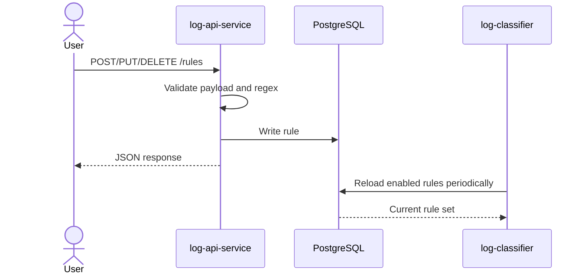

# Log Rule API Service

The React application is deployed independently from the top-level `ui/`
directory. This service exposes the APIs consumed by that UI.

## UI APIs

- `/api/login` accepts the configured single administrator account. Local
  defaults are `admin` / `admin`.
- `/api/dashboard` queries matched alerts from InfluxDB and returns summary
  metrics, chart series, and raw rows.
- `/api/rules` provides authenticated rule CRUD for the Settings screen.

The current login is intentionally suitable only for local development;
replace the credentials and session secret in Helm values before exposure.

The API service is the control plane for classifier rules. It validates HTTP requests and stores rule metadata in PostgreSQL. The classifier notices changes on its next refresh, so rule updates do not require a deployment restart.



## Endpoints

| Method | Path | Purpose |
|---|---|---|
| `GET` | `/healthz` | Process health check |
| `GET` | `/rules` | List all rules |
| `POST` | `/rules` | Create a rule |
| `GET` | `/rules/{id}` | Read one rule |
| `PUT` | `/rules/{id}` | Replace one rule |
| `DELETE` | `/rules/{id}` | Delete one rule |

Example rule:

```json
{
  "name": "authentication-failure",
  "rule_type": "regex",
  "pattern": "login failed.*status code (401|403)",
  "enabled": true,
  "namespace_scopes": ["test-logger", "payments"],
  "pod_scopes": [],
  "container_scopes": ["logger", "api"]
}
```

An empty scope array means global. Scope values are exact matches, while `pattern` is interpreted according to `rule_type`.

The older singular fields (`namespace_scope`, `pod_scope`, and `container_scope`) are accepted for compatibility and converted into arrays.

## Default rules

The Helm chart passes seed rules through `SEED_RULES_JSON`. On startup, the service creates the table and inserts those rules only when the table has zero rows. Existing data is never overwritten by a restart or by changing Helm seed values.

The chart currently seeds two enabled global keyword rules:

- `warning-keyword` matching `WARNING`
- `error-keyword` matching `ERROR`

## Local access

The service is ClusterIP-only by default. Forward it locally with:

```bash
kubectl port-forward -n log-monitor svc/log-monitor-log-api-service 8080:8080
curl -s http://127.0.0.1:8080/rules | jq
```

The current API has no authentication or authorization and should not be exposed publicly without adding them.

