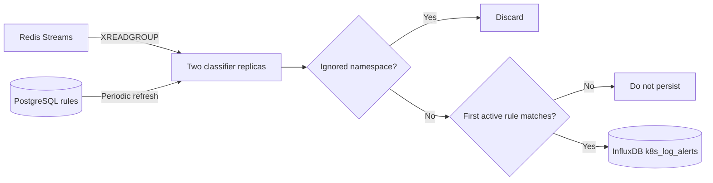

# Log Classifier

The log classifier consumes Kubernetes log entries from Redis, applies active PostgreSQL rules, and stores matching alerts in InfluxDB.

## Startup

The service connects to Redis, InfluxDB, and PostgreSQL. It creates or migrates the `log_match_rules` table, loads enabled rules, compiles regex rules, and begins discovering Redis keys matching `REDIS_STREAM_GLOB`.

## Redis consumption

The Helm chart runs two classifier replicas. Both use the shared `CONSUMER_GROUP`, while the Kubernetes pod name supplies a unique `CONSUMER_NAME`.

Redis consumer groups exist independently on each stream. During discovery, every replica ensures the group exists with `XGROUP CREATE ... MKSTREAM`; concurrent `BUSYGROUP` responses are treated as success. With `START_FROM_END=true`, a newly created group starts at `$` and consumes future entries.

Each replica issues one `XREADGROUP` across all known streams using `>` and reads up to 100 previously undelivered entries. Redis assigns each new entry to one consumer in the group, so the two replicas share work instead of processing duplicates.

There is no internal worker pool. Each replica processes its assigned batch one message at a time:

1. Ignored entries are acknowledged immediately.
2. Unmatched entries are acknowledged after rule evaluation.
3. Matched entries are acknowledged only after the blocking InfluxDB write succeeds.
4. Failed writes remain in the consumer group's pending-entry list.

Every `CLAIM_EVERY`, each replica uses `XAUTOCLAIM` to recover entries that have remained pending longer than `CLAIM_MIN_IDLE`. Delivery is therefore at least once: a crash after writing to InfluxDB but before `XACK` can cause a retry.

One main goroutine per replica performs discovery, rule refresh, pending recovery, Redis reads, matching, InfluxDB writes, and acknowledgements sequentially.

## Dynamic rules

Every `RULE_REFRESH_EVERY`, active rows are reloaded from PostgreSQL. A refresh failure keeps the previous valid in-memory rule set. Invalid regex rows are skipped and logged.

Supported rule types:

- `keyword`: case-insensitive substring matching.
- `regex`: Go regular-expression matching; use `(?i)` in the pattern for case-insensitive matching.

Each rule may contain multiple exact scopes:

- `namespace_scopes`
- `pod_scopes`
- `container_scopes`

An empty array means all values. Values inside one array use OR logic, while the three scope categories use AND logic. Rules are checked by database ID and processing stops at the first match.

The global `IGNORED_NAMESPACES` check runs before rule matching. By default, `log-monitor` logs are consumed from Redis but are not matched or stored in InfluxDB.

## InfluxDB output

Only matched logs are written to measurement `k8s_log_alerts`.

Tags include namespace, pod, container, stream, match type, pattern, and rule name. Fields include the log text, raw CRI line, Redis stream/ID, container ID, timestamps, rule ID, and scope summary.

## Configuration

| Variable | Default | Purpose |
|---|---:|---|
| `REDIS_ADDR` | `log-monitor-redis:6379` | Redis endpoint |
| `REDIS_STREAM_GLOB` | `logs:k8s*` | Stream discovery pattern |
| `CONSUMER_GROUP` | `log-classifiers` | Shared Redis group name |
| `CONSUMER_NAME` | pod hostname | Unique consumer identity |
| `DISCOVER_EVERY` | `10s` | Redis discovery interval |
| `READ_BLOCK` | `5s` | `XREADGROUP` blocking duration |
| `START_FROM_END` | `true` | Start newly created groups at `$` |
| `CLAIM_EVERY` | `30s` | Pending-message recovery interval |
| `CLAIM_MIN_IDLE` | `1m` | Minimum idle time before reclaim |
| `RULE_REFRESH_EVERY` | `15s` | PostgreSQL rule refresh interval |
| `IGNORED_NAMESPACES` | `log-monitor` | Comma-separated global exclusions |
| `POSTGRES_*` | varies | Rule database connection |
| `INFLUX_*` | varies | Alert database connection |

