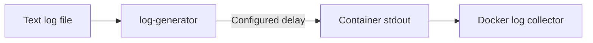

# Log Generator (Legacy Test Utility)

The log generator repeatedly prints lines from a text file to stdout at a configurable rate. A Docker log collector can then observe those lines as ordinary container logs.

Configuration:

- `LOGFILE` defaults to `/logs/cleaned_logs.txt`.
- `SPEED` defaults to one line per second.

After reaching the end of the file, the generator opens it again and repeats indefinitely. The current Kubernetes chart uses its own BusyBox `test-logger` instead of this utility.

