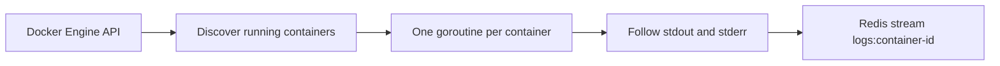

# Docker Log Streamer (Legacy)

This is the original Docker-specific collector. It is not used by the current Kubernetes Helm deployment.

The service lists running Docker containers every ten seconds. For each new container, it starts a goroutine that follows `ContainerLogs`, removes Docker's eight-byte multiplexing header, and writes each line with `XADD`.

Each Redis entry contains `container_id`, `container_name`, `log`, and a Unix timestamp. This older implementation has no Kubernetes metadata, stream trimming, expiry, persistent offsets, or retry queue.

Use `go_pipeline/k8s-log-streamer` for the active Kubernetes deployment.

