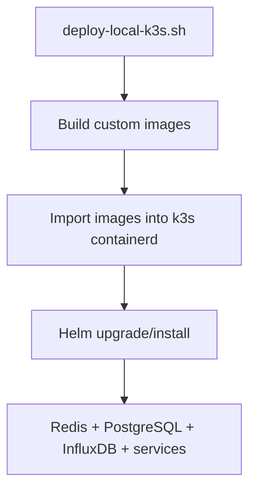

# Kubernetes Deployment

This folder contains the Helm chart and local k3s lifecycle scripts for the active Log Monitor stack.



## Layout

- `helm/log-monitor` contains templates and values for the complete stack.
- `scripts/deploy-local-k3s.sh` builds/imports images and installs or upgrades the release.
- `scripts/undeploy-local-k3s.sh` removes the release and namespaces.

The chart deploys:

- Redis
- PostgreSQL with persistent storage
- InfluxDB with persistent storage
- `k8s-log-streamer` as a DaemonSet
- `log-classifier` as a Deployment
- `log-api-service` and its ClusterIP Service
- a BusyBox test logger in the `test-logger` namespace

## Local k3s workflow

From the repository root:

```bash
chmod +x k8s/scripts/deploy-local-k3s.sh
./k8s/scripts/deploy-local-k3s.sh
```

The script builds and imports these local images:

- `k8s-log-streamer:dev`
- `log-classifier:dev`
- `log-api-service:dev`

`values.local-k3s.yaml` uses `imagePullPolicy: Never` for those images, so they must exist inside the k3s containerd image store.

## Validation

```bash
kubectl get pods -n log-monitor
kubectl get pods -n test-logger
kubectl logs -n log-monitor deploy/log-monitor-log-classifier --tail=50
kubectl port-forward -n log-monitor svc/log-monitor-log-api-service 8080:8080
```

Then list rules from another terminal:

```bash
curl -s http://127.0.0.1:8080/rules | jq
```

See the [Helm chart README](helm/log-monitor/README.md) for the component diagram and chart-specific commands.
