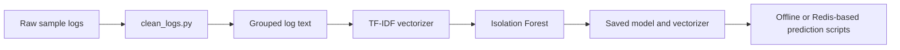

# Machine-Learning Prototype

This folder contains the original offline and real-time anomaly-detection experiments. It is not connected to the current Kubernetes classifier deployment.

## Scripts

- `clean_logs.py` removes known timestamp prefixes from historical log files.
- `train_iso.py` groups every five lines, creates TF-IDF vectors, and trains an Isolation Forest.
- `detect_anomly.py` performs offline scoring against sample logs and writes `anomaly_results.csv`.
- `predict_anomly_real_time.py` reads one hard-coded Docker Redis stream through a consumer group and prints detected anomalies.
- `tf-idf.py`, `training_hash_iso.py`, `detect_anomly_hash_iso.py`, and the notebook are additional experiments.

These scripts currently use local paths, hard-coded model names or stream IDs, and are not packaged in the Helm chart. The active `log-classifier` uses PostgreSQL keyword/regex rules, not these ML models.

